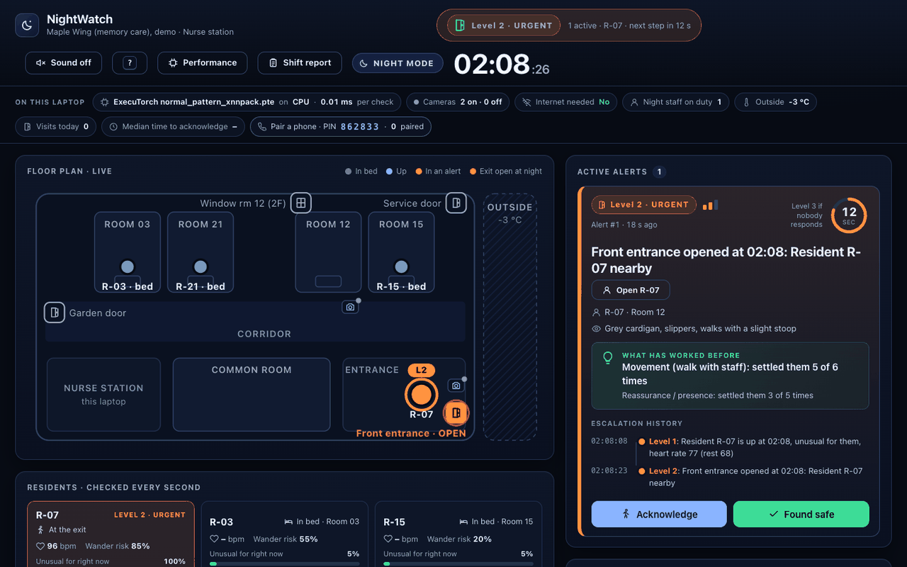
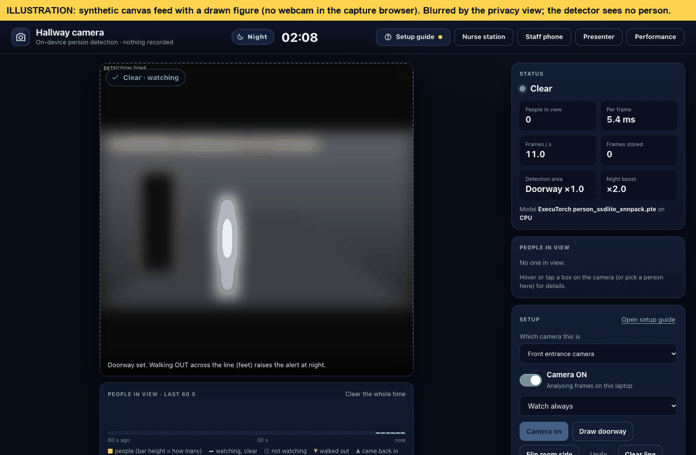
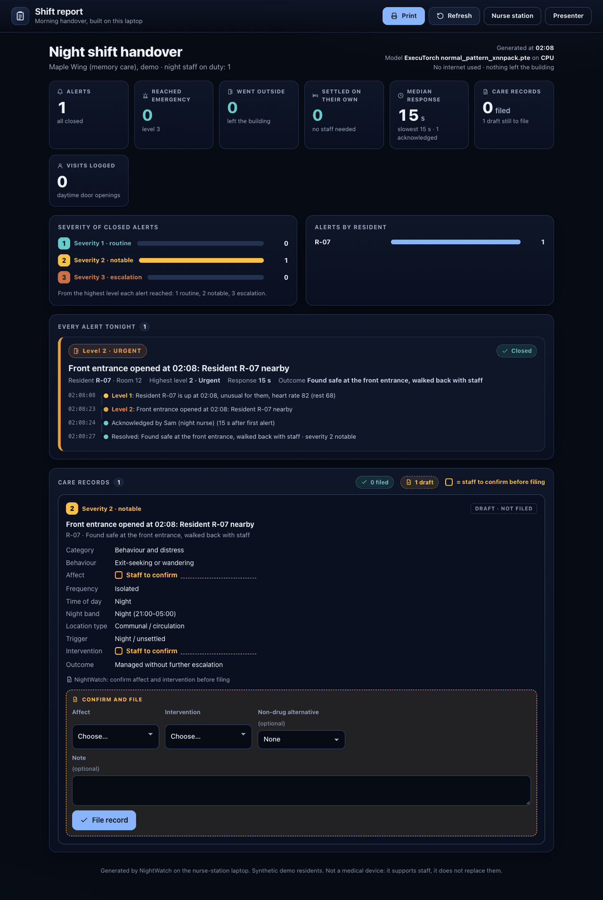
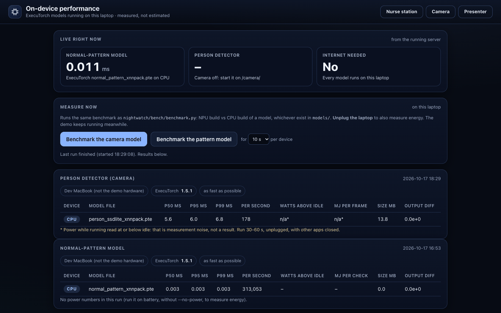
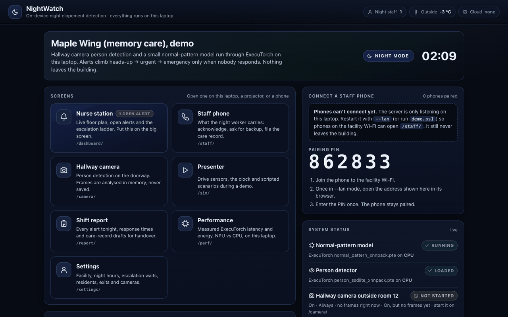
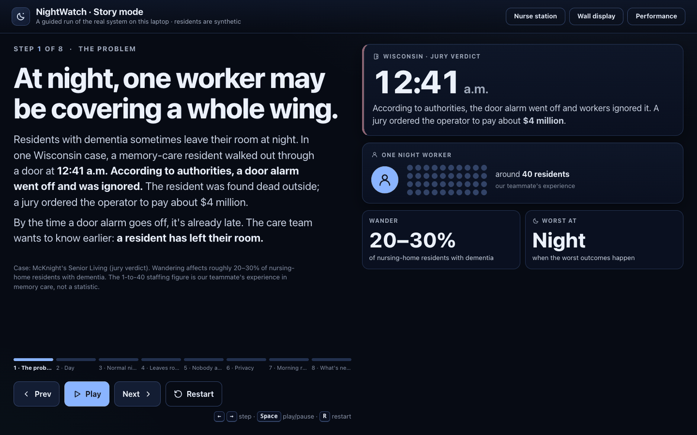
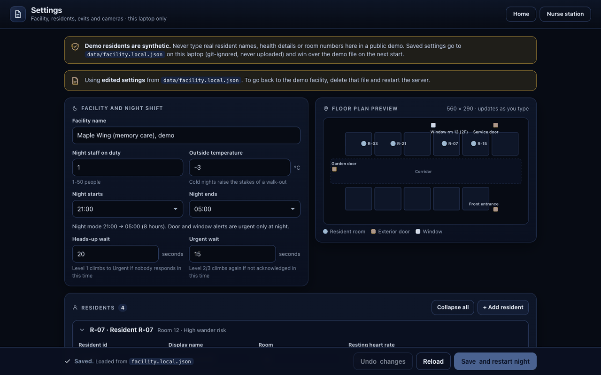
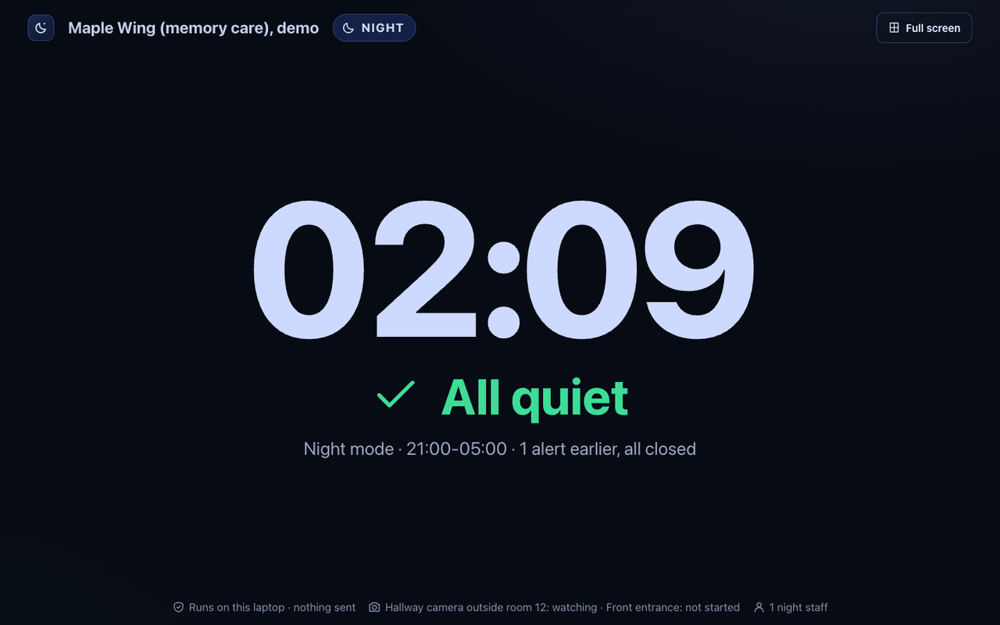

# NightWatch

**On-device night supervision for memory care: it notices when a resident with dementia leaves their room
or heads for a door at 2 a.m., and keeps escalating until a human responds. Nothing leaves the building.**

ExecuTorch Hackathon 2026, Compute track (Copilot+ PC, Snapdragon X Elite).
Judges: a 2-minute guided tour is in **[docs/JUDGES.md](docs/JUDGES.md)**.

- **Sees the moment that matters.** A hallway camera runs a person detector through ExecuTorch on the laptop;
  when a resident's feet cross the doorway line going out at night, the night phone gets a quiet heads-up.
- **Climbs only when nobody answers.** Heads-up → urgent (exit door opens) → emergency (still no answer):
  all phones, on-call supervisor, then the facility's emergency chain. "I'm going" stops the climb.
- **Hands over the paperwork.** Every closed alert gets the care team's severity badge and a draft care-record
  entry in their format; the morning shift report is one page.



<sub>Nurse station at 02:08 during the scripted *R-07 heads for the front door* scenario. Residents are synthetic.</sub>

## Run it in 60 seconds

```bash
pip install -r requirements.txt     # Windows on ARM: powershell -ExecutionPolicy Bypass -File setup_windows.ps1
./demo.sh                           # Snapdragon laptop: powershell -ExecutionPolicy Bypass -File demo.ps1
```

The demo script picks the NPU (QNN) models if they are in `models/`, otherwise the CPU (XNNPACK) ones that are
committed, starts the server on the local network and opens the nurse station, the presenter page and the camera.
Then:

1. On <http://localhost:8000/sim/> (presenter page) click **R-07 heads for the front door** (02:08 · night, key **1**).
2. Watch <http://localhost:8000/dashboard/>: a heads-up, then the front door opens (urgent), then, if nobody
   answers, the full-screen emergency view. Open <http://localhost:8000/staff/> in another window to be the
   night nurse: tap **I'm going** and the climb stops; **Found safe** closes it.
3. Click **R-15 ensuite trip** (key **2**): a normal 3 a.m. bathroom trip. Nothing fires.
4. Open <http://localhost:8000/report/> for the morning handover, and <http://localhost:8000/perf/> for live
   ExecuTorch timings.

The full judge walkthrough, including the camera, is in [docs/JUDGES.md](docs/JUDGES.md).

## Why on-device

- **Offline.** Facility internet drops at night. Everything (models, alerts, phones over the local Wi-Fi) works
  with the internet unplugged; the dashboard shows "Internet needed: No".
- **Privacy.** Cameras pointed at people with dementia can't stream to a cloud. Frames are analysed in memory
  and dropped; only positions reach the alert logic; the nurse station shows a radar, never video. Each camera
  can be off or night-only, and off means the webcam is released.
- **Cost.** No per-camera cloud fees or subscriptions: one laptop at the nurse station.
- **NPU.** A detector looking at a doorway all night is exactly the always-on, low-power workload the Hexagon
  NPU is for. Both models export to Qualcomm QNN for the NPU and XNNPACK for the CPU.

## How the AI works

Two models run through **ExecuTorch** (`.pte` files, XNNPACK on the CPU or QNN on the Hexagon NPU):

| Model | What it decides | Details |
|---|---|---|
| **Person detector** (SSDlite320-MobileNetV3, COCO weights) | Where people are in each hallway frame | int8 via PT2E: 3.9 MB instead of 13.8 MB, same boxes on our checks. A tracker gives each person an id; only feet crossing the doorway line *going out* count. [More](#hallway-camera-person-detection-on-the-device) |
| **Normal-pattern model** (~850 parameters) | "Is this unusual for this resident *right now*?" | 8 live features; trained to tell real moments from scrambled ones, so no labelled incidents are needed. [More](#the-model) |

**Rules for the safety-critical part.** A door opening at 2 a.m. doesn't need a model. Night rules and the
escalation ladder are deterministic, so they are predictable and testable; AI is used for what has to be *seen*
or *judged in context*. If a model fails to load, the server says so and a rule fallback keeps watching.
Diagram and data map: [docs/ARCHITECTURE.md](docs/ARCHITECTURE.md).

## Measured performance

Open <http://localhost:8000/perf/> while the demo runs: live time per check and per frame, plus a button that runs
the NPU-vs-CPU benchmark on this laptop. Method and tables: [Benchmark](#benchmark) and
[nightwatch/bench/README.md](nightwatch/bench/README.md).

What is measured so far is from a **dev MacBook CPU (XNNPACK)**, not the Snapdragon laptop:

| Model | p50 per call | Throughput |
|---|---|---|
| Person detector, fp32 | 5.5 ms | ~180 frames/s |
| Person detector, int8 | 5.3 ms (vs 5.7 ms fp32 in the same check) | — |
| Normal-pattern model | 0.004 ms | ~220,000 checks/s |

**Snapdragon X Elite CPU and NPU numbers are not in this README until they are measured** on the laptop and
recorded in [nightwatch/bench/README.md](nightwatch/bench/README.md). We don't quote estimates.

## Honest limits

- The normal-pattern model learned "normal" from **simulated** days. In a facility it would learn each
  resident's own pattern from their first weeks.
- Demo residents are **synthetic** ([nightwatch/demo/facility.json](nightwatch/demo/facility.json)); every number there is invented.
- The presenter scenario **Camera: R-07 walks out (simulated)** plays **simulated** camera data and is tagged SIMULATED on screen.
- The Level 3 contact chain is **simulated**: it never calls or texts anyone, and never auto-dials 911.
- Other sensor events in the demo come from the browser simulator; real door and heart-rate bridges exist (see [Sensors](#sensors)).
- NPU results: see [Measured performance](#measured-performance). Until they are in the bench README, the claim is
  "built for the NPU", not "runs on the NPU".
- Not a medical device. It supports staff; it does not replace them.

## Screens

| | |
|---|---|
|  |  |
| **Staff phone** `/staff/` (375 px): what to look for, what has calmed this resident before, one-tap answers. | **Emergency** at the nurse station: still no answer, so all phones and the contact chain (simulated). |
|  |  |
| **Camera radar** during *Camera: R-07 walks out* (simulated camera data, tagged on screen). Positions only, never video. | **Camera page** `/camera/`: privacy view, live ms/frame, doorway set. **The feed in this screenshot is an illustration** (a drawn figure on a synthetic canvas; the capture browser has no webcam), so the detector correctly reports no person. |
|  |  |
| **Shift report** `/report/`: alerts, response times, severity, draft care records, camera switches. | **Performance** `/perf/`: live ExecuTorch timings; runs labelled with the machine they came from. |
|  |  |
| **Home** `/`: every screen, phone pairing PIN, system status. | **Story mode** `/story/`: a guided run of the real system. |
|  |  |
| **Settings** `/settings/`: night hours, escalation waits, residents, exits, cameras (local only). | **Wall display** `/wall/`: one glanceable status for a corridor screen. |

Also on the laptop: `/help/` (help) and `/family/` ("How was their night?").

---

## Contents

- [The problem](#the-problem)
- [What NightWatch does](#what-nightwatch-does)
- [The model](#the-model)
- [Run it (details)](#run-it-details)
- [Hallway camera (person detection on the device)](#hallway-camera-person-detection-on-the-device)
- [Phone pairing (security)](#phone-pairing-security)
- [Sensors](#sensors)
- [Demo script (≤ 5 min)](#demo-script--5-min)
- [Benchmark](#benchmark)
- [Data and privacy](#data-and-privacy)
- [Sources](#sources)
- Other docs: [docs/JUDGES.md](docs/JUDGES.md) · [docs/ARCHITECTURE.md](docs/ARCHITECTURE.md) · [docs/PITCH.md](docs/PITCH.md) · [docs/SUBMISSION.md](docs/SUBMISSION.md) · [docs/DEMO_VIDEO.md](docs/DEMO_VIDEO.md)

## The problem

People with dementia wander and try to leave ("elopement"), and the worst outcomes happen at night,
when one staff member may be covering a whole wing. Door alarms exist, but an alarm that nobody
answers doesn't help: in one Wisconsin case, a memory-care resident left through a door at 12:41 a.m.
whose alarm workers ignored, according to authorities, and was found dead outside; a jury ordered the
operator to pay about $4M
([McKnight's](https://www.mcknightsseniorliving.com/news/operator-ordered-to-pay-4-million-to-family-after-jury-finds-assisted-living-community-disregarded-safety-of-memory-care-resident/)).
See [Sources](#sources) for more cases and the numbers we cite.

## What NightWatch does

| Level | When | What happens |
|---|---|---|
| 1 Heads-up | At night, a resident leaves their room (hallway camera doorway line or location sensors), or the model says what they're doing is unusual *for this time* | Quiet alert on the night staff phone, with what has calmed this resident before |
| 2 Urgent | An exit door or window opens at night, the entrance camera sees someone, or a heads-up gets no response | Loud alert, must be acknowledged |
| 3 Emergency | Still no acknowledgement, or a resident is confirmed outside | All phones alarm, on-call supervisor, then emergency services per facility policy |

- **Escalation only climbs when nobody responds.** One worker for a whole wing is often busy elsewhere; the system keeps going for them.
- **Day vs night.** During the day, door openings are logged as visits. From 21:00 to 05:00 (the night band used in care records), the same door is urgent.
- **No false alarms for normal nights.** A short ensuite trip at 3 am stays quiet; a heads-up clears itself when the resident settles back into bed.
- **Speaks the care team's language.** Every closed alert gets the team's derived severity badge (1 routine / 2 notable / 3 escalation, from the highest level reached) and a draft care-record entry in their event format: location as a type (never a room), night as a band, affect and intervention left for staff to confirm. Less paperwork for the one person on nights.
- **It never dials anyone in this build.** Contact steps are shown and logged as "(simulated)".

**Architecture diagram and data map:** [docs/ARCHITECTURE.md](docs/ARCHITECTURE.md).

It works when the facility's internet drops at night, resident data never leaves the building,
and checks take a fraction of a millisecond, so every resident is checked every second.
The "is this normal for right now?" model runs through **ExecuTorch**: XNNPACK on the CPU, or the
Qualcomm (QNN) backend on the **Hexagon NPU**.

## The model

[`nightwatch/model/train_anomaly.py`](nightwatch/model/train_anomaly.py): a ~850-parameter network over 8 live features (time of day,
in/out of bed, movement, heart rate vs resting, corridor, exit zone, minutes up). It is trained to tell
real normal moments from scrambled ones, so it scores *combinations*: the corridor is normal at 2 pm and
unusual at 2 am. It needs no labeled incidents, which matters because real elopement data is rare.

| Moment | Unusual score |
|---|---|
| 2:12 am, up 12 min, at an exit, HR +30 | 1.00 |
| 2:12 am, in the corridor, HR +15 | 1.00 |
| 3:00 am, short ensuite trip | 0.30 |
| 2:00 pm, walking the corridor | 0.07 |

Alerts need a score of at least 0.9 sustained for 5 seconds. **Honest note:** in this build "normal"
comes from *simulated* days. In a facility it would be learned from each resident's own first weeks of data.

## Run it (details)

**Demo in one command** (starts the server with the best available models, NPU if built, and opens the screens):
`powershell -ExecutionPolicy Bypass -File demo.ps1` on the Snapdragon laptop (add `-Pin 246810` to fix the phone PIN),
or `./demo.sh` on macOS/Linux (`PIN=246810 ./demo.sh`).

Fastest path on any machine: install, then let the health check tell you what works and print the start command.

```bash
pip install -r requirements.txt        # Windows on ARM: powershell -ExecutionPolicy Bypass -File setup_windows.ps1
python nightwatch/check.py             # add --npu once the QNN models are in models/
python -m pytest -q tests              # escalation rules, camera confirmation, tracker, box decoding, pairing
```

Python 3.10+. The server is standard library only; loading a model needs `torch` and `executorch`
(plus `pillow` for the camera).

```bash
python nightwatch/server.py --model models/normal_pattern_xnnpack.pte --device CPU --l1-timeout 20 --ack-timeout 15
```

Open three tabs: <http://localhost:8000/dashboard/> (nurse station), <http://localhost:8000/staff/> (night
staff phone), <http://localhost:8000/sim/> (presenter page and sensor simulator). Add `--lan` so a real phone on the same Wi-Fi
can open `/staff/` at this computer's IP. The full API is documented at the top of
[nightwatch/server.py](nightwatch/server.py).

Retrain / re-export:

```bash
pip install torch executorch
python nightwatch/model/train_anomaly.py
cd nightwatch/model && python export.py --backend xnnpack
```

NPU (Snapdragon X Elite): the QNN compile needs an x86_64 host with the Qualcomm AI Engine Direct SDK and
ExecuTorch's Qualcomm backend (not a Mac, not natively on Windows on ARM):

```bash
cd nightwatch/model && python export.py --backend qnn
python nightwatch/server.py --model models/normal_pattern_qnn.pte --device NPU
```

If a model fails to load, the server says so and keeps watching with a rule fallback; the dashboard always
shows which model and device are live.

## Hallway camera (person detection on the device)

The strongest signal that someone left their room at night is *seeing* it. `/camera/` opens a webcam in the
browser and sends frames to the local server, where a person detector (torchvision SSDlite320-MobileNetV3,
COCO weights) runs through **ExecuTorch**: about 6 ms per frame on a MacBook CPU with XNNPACK, NPU via QNN.
Frames are analysed in memory and dropped; nothing is recorded or sent anywhere, and the page shows a blurred
view by default.

**Precision:** a tracker ([`nightwatch/vision/tracker.py`](nightwatch/vision/tracker.py)) gives each person a stable id across frames, smooths
their box, needs 0.5 confidence to start following someone but keeps them down to 0.3 (half-hidden people aren't
dropped), and the whole frame is letterboxed in (nothing cut off at the edges). On the camera page you click two
points to **draw the doorway line** and flip which side is the room; then only someone's *feet crossing the line
going out* counts, so a person walking along the hallway or staff passing by don't fire. Crossing back in closes
the heads-up. With no line drawn, three frames in a row with a person counts. At night, the hallway camera outside room 12
means R-07 left their room (heads-up); the front-entrance camera means someone is at the exit (urgent).

```bash
python nightwatch/vision/export_detector.py --backend xnnpack     # needs torchvision; writes the .pte + anchors
python nightwatch/server.py --model models/normal_pattern_xnnpack.pte --camera-model models/person_ssdlite_xnnpack.pte
```

**Image quality and precision, continued:** the tracker predicts each person's motion (fast walkers and short
occlusions keep their id) and only counts a crossing once the feet stay on the new side for 2 frames (no flicker
when someone stands on the line). With a doorway drawn, the page sends a **zoomed crop around the door** to the
detector, so people there appear larger, and **night boost** auto-stretches brightness/contrast of dark frames
(capped at ×4 to avoid amplifying sensor noise) before detection.

**Camera on/off and night only:** each camera can be turned off or set to watch only at night (21:00-05:00),
from the camera page or the nurse station. Off means off: the server drops frames without decoding them and the
camera page releases the webcam (its light goes off). Every switch is logged with who did it.

**8-bit model:** `export_detector.py --int8 --calib data/calib` quantizes the detector (PT2E). 3.9 MB instead of
13.8 MB, same boxes on our checks (box overlap 0.95-0.99), and int8 is the format the Hexagon NPU is built for
(`--backend qnn --int8`). On a MacBook CPU it's only slightly faster (5.3 vs 5.7 ms). Calibrate on a few dozen
real frames from the demo camera (kept in git-ignored `data/calib`, deleted afterwards) for best accuracy.

The exported `.pte` and anchors are committed, so the laptop only needs `torch` + `executorch` + `pillow`
(no torchvision). For the NPU: `python nightwatch/vision/export_detector.py --backend qnn` on an x86_64 host with
the QNN SDK, then `--camera-model models/person_ssdlite_qnn.pte --camera-device NPU`.

## Phone pairing (security)

With `--lan`, staff phones reach the laptop over the facility Wi-Fi, so NightWatch makes sure only staff devices
can see or answer alerts. The laptop itself is trusted; any other device must enter the **6-digit PIN shown on
the nurse-station dashboard** (also printed at startup) once. It then gets a random token that it sends with every
request; only a hash is stored (`logs/paired_devices.json`, git-ignored). Wrong PINs lock a device out for 60 s
after 5 tries. Pages hold no data; every `/api/` call from another device without a valid token gets `401`.
`--pin 123456` fixes the PIN for a demo; `--unpair-all` forgets every phone. Code: [nightwatch/pairing.py](nightwatch/pairing.py).

## Sensors

| Sensor | Demo | Real |
|---|---|---|
| Door / window contact | `/sim/` (key **D** = front door) | Arduino + reed switch: [`hardware/door_sensor/door_sensor.ino`](hardware/door_sensor/door_sensor.ino) → `python nightwatch/bridges/door_serial.py --port COM5` |
| Heart rate | `/sim/` slider, or `hr_bridge.py --simulate` | A watch broadcasting the standard Bluetooth heart-rate service → `python nightwatch/bridges/hr_bridge.py --ble "Charge 6" --resident R-07` |
| Bed / location | `/sim/` | Bed pressure mat, room/corridor beacons |

Everything posts to `POST /api/sensor` (see [nightwatch/server.py](nightwatch/server.py)).

## Demo script (≤ 5 min)

1. **Day (14:00).** Presenter page (`/sim/`) → *Visitors come and go*. Doors open, visits are logged, no alarms.
2. **Normal night (03:00).** *R-15 ensuite trip*. Resident gets up, goes back to bed. Nothing fires.
3. **The real thing (02:08).** *R-07 heads for the front door*. Heads-up on the phone → front door opens → urgent → nobody answers → emergency, supervisor, then "emergency services would be called now".
4. Run 3 again and tap **I'm going** on the phone: escalation stops; **Found safe** closes it.
5. Turn Wi-Fi off. It keeps working.

Spoken version: [docs/PITCH.md](docs/PITCH.md). Video shot list: [docs/DEMO_VIDEO.md](docs/DEMO_VIDEO.md).

## Benchmark

**On screen:** `/perf/` shows the live time per check and per frame, plus the latest benchmark runs (NPU vs CPU
speedup, energy, output match) as soon as the team runs `nightwatch/bench/benchmark.py` (or presses the benchmark
button on the page).

[`nightwatch/bench/benchmark.py`](nightwatch/bench/benchmark.py) compares each model on the Hexagon NPU (QNN) and the CPU (XNNPACK): p50/p95/p99
latency, throughput, whole-laptop power above an idle baseline (battery gauge, so run unplugged), energy per
frame/check, memory, and a check that both backends give the same outputs on the same inputs. It detects the
model from the `.pte`. On the Snapdragon X Elite laptop, from the repo root:

```bash
python nightwatch/bench/benchmark.py --pte models/person_ssdlite_qnn.pte:NPU --pte models/person_ssdlite_xnnpack.pte:CPU --rate max
python nightwatch/bench/benchmark.py --pte models/person_ssdlite_qnn.pte:NPU --pte models/person_ssdlite_xnnpack.pte:CPU --rate 5 --cameras 2
python nightwatch/bench/benchmark.py --pte models/normal_pattern_qnn.pte:NPU --pte models/normal_pattern_xnnpack.pte:CPU --rate max
```

The person detector is the main NPU workload (`--rate 5` = 5 frames/s per camera, what `/camera/` sends). Results
go to `logs/bench/`; setup, caveats and the results tables are in [nightwatch/bench/README.md](nightwatch/bench/README.md).

## Data and privacy

- Residents in the demo are **synthetic** ([`nightwatch/demo/facility.json`](nightwatch/demo/facility.json)); every number there is invented.
- The design was informed by a memory-care professional on our team and de-identified care records.
  Those records stay in `data/` (git-ignored) and are never committed. [`tools/build_profile.py`](tools/build_profile.py) turns them
  into aggregate-only profiles, locally.

## Sources

Allegations in lawsuits are allegations, not findings. Check amounts against court records before quoting.

- $110M jury verdict, Sacramento: a 100-year-old resident with Alzheimer's died of hypothermia after leaving an assisted-living facility ([Expert Institute](https://www.expertinstitute.com/resources/insights/110m-verdict-assisted-living-elopement/), [Nursing Home Abuse Center](https://www.nursinghomeabusecenter.com/blog/110-million-wrongful-death-lawsuit-against-assisted-living-facility/)). Some reports say $100M.
- About $4M jury verdict, Wisconsin: door alarm ignored at 12:41 a.m. ([McKnight's Senior Living](https://www.mcknightsseniorliving.com/news/operator-ordered-to-pay-4-million-to-family-after-jury-finds-assisted-living-community-disregarded-safety-of-memory-care-resident/)).
- Oregon: family sued a memory-care center and the state after a resident wandered away and froze to death ([OPB](https://www.opb.org/article/2024/04/17/senior-elder-memory-dementia-care-sandy-oregon-ki-soon-hyun-mt-hood/), [KGW](https://www.kgw.com/article/news/local/family-sues-memory-care-center-resident-dementia-escape-death-oregon/283-b6849400-d1f2-42e0-b988-52a0bc36dbfb)).
- Window fall: a dementia patient died after jumping from a second-story window; the state ordered the memory-care unit moved to the first floor ([source](https://nursing-home-neglect.com/dementia-patient-dies-after-jumping-out-of-second-story-window/)).
- Wandering affects roughly 20-30% of nursing-home residents with dementia, depending on study and setting ([Caring for the Ages](https://www.caringfortheages.com/article/S1526-4114(22)00409-7/fulltext), [US News](https://health.usnews.com/senior-care/wandering-and-elopement-in-nursing-homes)).

Not a medical device. It supports staff; it does not replace them.

---

[`archive/struggle-detector/`](archive/struggle-detector/) holds the team's earlier prototype (website frustration detector).
