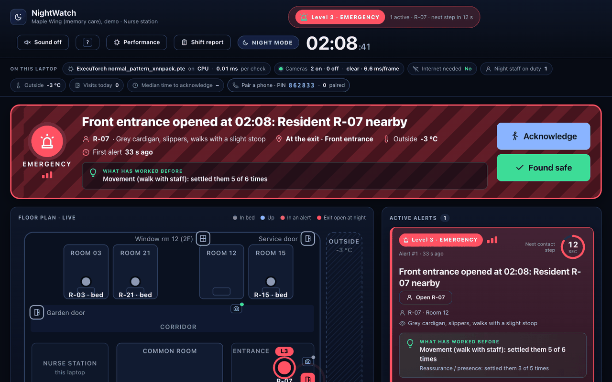
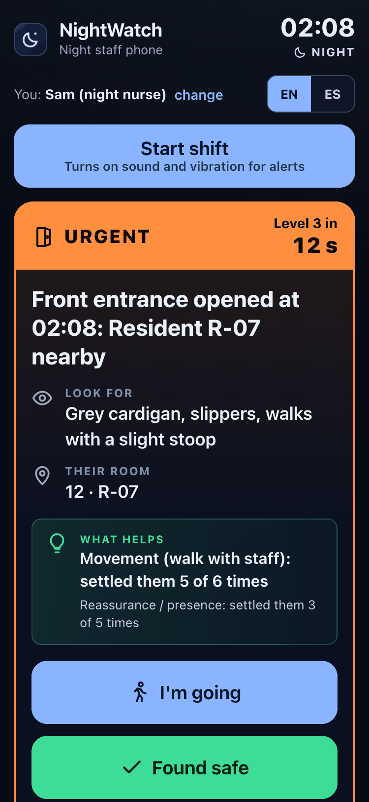
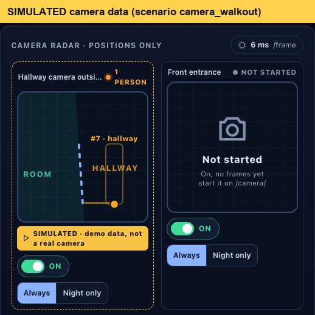

# NightWatch in 2 minutes: a guided tour for judges

You have the laptop in front of you. The server is already running (if not: `./demo.sh`, or
`powershell -ExecutionPolicy Bypass -File demo.ps1` on the Snapdragon laptop, from the repo root).
Everything below happens on this laptop; you can unplug the network first if you like.

Residents are **synthetic**. Anything marked *simulated* below is labelled that way on screen too.

## 0:00 · Start at the home page

Open <http://localhost:8000/> (it goes to `/home/`).

**You should see:** every screen as a card, a 6-digit phone-pairing PIN, and *System status* showing the
ExecuTorch models that are live (`normal_pattern_*.pte`, `person_ssdlite_*.pte`) and whether they run on CPU or NPU.

## 0:15 · Set up two windows

- Window 1: <http://localhost:8000/dashboard/>, the nurse station.
- Window 2: <http://localhost:8000/sim/>, the presenter page. Optionally a narrow third window on
  <http://localhost:8000/staff/>, the night nurse's phone (or a real phone on the same Wi-Fi, after entering the PIN).

## 0:25 · The unanswered night (the core of the product)

On the presenter page, click **R-07 heads for the front door** (or press **1**). Don't touch anything else.

| Time | What you should see on the nurse station |
|---|---|
| ~8 s | Clock jumps to **02:08 · NIGHT**. Level 1 **heads-up**: R-07 is up, unusual for this hour (the normal-pattern model through ExecuTorch). A countdown shows when it climbs. |
| ~23 s | R-07 reaches the exit, the **front entrance opens**: Level 2 **urgent**, door turns red on the floor plan. |
| ~38 s | Nobody answered, so Level 3 **emergency**: a full-width red takeover at the top, all phones alarmed, then the contact chain (on-call supervisor, emergency services) shown and logged as **(simulated)**. Nothing is actually dialled. |

## 1:00 · The answered night

Press **1** again. When the heads-up or urgent alert appears, open the staff phone (`/staff/`) and tap **I'm going**.

**You should see:** the climb stops and the alert's history says *Acknowledged by …*. Tap
**Found safe**: the alert closes with a severity badge (1 routine / 2 notable / 3 escalation).

## 1:15 · A normal night stays quiet

Click **R-15 ensuite trip** (or press **2**). R-15 gets up at 03:00 and goes back to bed.
**You should see:** no alert. Click **Visitors come and go** (**3**): at 14:00, doors are logged as visits, no alarms.

## 1:25 · The camera (person detection on the device)

- **Live, if a webcam is attached:** open <http://localhost:8000/camera/>, pick *Hallway camera outside room 12*,
  **Start camera**, **Draw doorway** (two clicks on the floor), click the **02:08 night** clock button on the presenter page,
  then walk out across the line. The phone gets "R-07 left their room". Walking along the hallway doesn't fire.
  The page shows a blurred privacy view, the ms per frame, and *Frames stored: 0*.
- **Without walking:** on the presenter page click **Camera: R-07 walks out** (**4**). This plays
  **simulated** camera data; the radar on the nurse station shows a yellow **SIMULATED** tag.

**You should see** on the nurse station's *Camera radar*: positions only (a dot and a box crossing from ROOM to
HALLWAY), never video. Try the camera's **ON** switch: off means the server drops frames undecoded.

## 1:40 · Morning handover and performance

- <http://localhost:8000/report/>: the shift report. Alerts, response times, severity, a timeline per alert,
  and a **draft care record** in the care team's format with affect and intervention left for staff to confirm.
- <http://localhost:8000/perf/>: live ExecuTorch time per check and per frame, and **Benchmark the camera model**,
  which runs NPU vs CPU (whatever builds exist in `models/`) on this laptop. Each run is labelled with the
  machine it ran on; runs from the developer MacBook say *Dev MacBook (not the demo hardware)*.

## 1:55 · Pull the network

Turn Wi-Fi off. **You should see:** everything keeps working; the dashboard reads *Internet needed: No*.

## What's real and what's simulated

| Real (running on this laptop) | Simulated or not yet verified |
|---|---|
| Two ExecuTorch models (`.pte`): person detector and normal-pattern model, CPU via XNNPACK; QNN export path for the NPU | Whether this run uses the NPU: check *System status* on `/home/` or the chips on the dashboard, which name the device |
| Person detection on webcam frames, tracker, doorway-line crossing, privacy view, camera off / night-only | **Camera: R-07 walks out** feeds simulated camera data (tagged SIMULATED) |
| Escalation ladder, day/night rules, acknowledgement, found safe, severity, draft care records, shift report | Residents and their profiles are synthetic; sensor events in scenarios come from the simulator |
| Phone pairing with a PIN over local Wi-Fi; works offline | The L3 contact chain never calls anyone: steps are shown and logged as (simulated) |
| `/perf/` measurements are real measurements of the machine they ran on | "Normal" for the small model was learned from simulated days |

More: [README](../README.md) (honest limits, measured performance) · [ARCHITECTURE.md](ARCHITECTURE.md) (diagram, data map).
