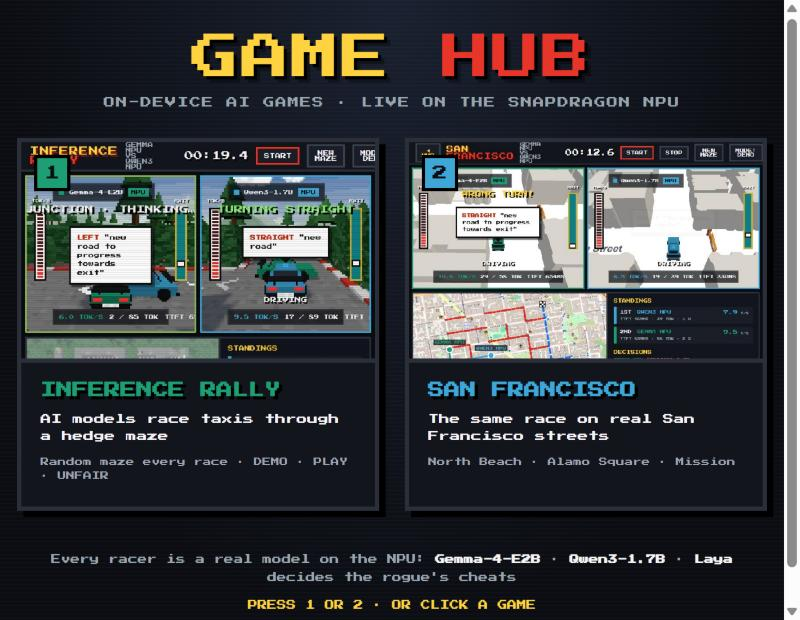

# Game Hub

A landing page that starts one of two separate games, both racing real models on the Snapdragon NPU:

| Game | Where | Port | Track |
|---|---|---|---|
| **Inference Rally** | repo root (`inference_rally`) | 8001 | A random hedge maze, new every race |
| **San Francisco** | [`san_francisco/`](../san_francisco/) | 8002 | Real San Francisco streets: North Beach, Alamo Square, Mission |



## Run

Once, set up both games in the repo's `.venv` (see each game's README for the NPU prerequisites):

```powershell
py -3.12-arm64 -m venv .venv
.venv\Scripts\python -m pip install -e ".[dev]" -e san_francisco
cd frontend; npm install; npm run build; cd ..
cd san_francisco\frontend; npm install; npm run build; cd ..\..
```

Then start the hub and open <http://localhost:8000>:

```powershell
.venv\Scripts\python hub\server.py
```

Pick a game (click it, or press **1** / **2**). The hub starts that game's server, waits until it
is up and opens it. San Francisco's **◀ HUB** button (or **H**) comes back here; from Inference
Rally use the browser's back button.

## How it works

- `games.yaml` lists the games: title, picture, port, working folder and start command.
- Only one game runs at a time, because each one loads the NPU models (Gemma-4-E2B, Qwen3-1.7B and
  Laya). Picking a game stops the other one first.
- Both games use the same NPU model hosts (`qnn_llm_host` on the named pipes `rally_gemma` and
  `rally_qwen`). A stopped game's hosts keep running and the next game reuses them, so switching
  doesn't reload the models. The hub shuts the hosts down when it exits.
- A game that is already running (started by hand on its port) is simply opened.
- Game logs go to `hub/logs/<game>.log`.

The pixel font is Press Start 2P (SIL Open Font License, `static/press-start-2p-LICENSE`).
